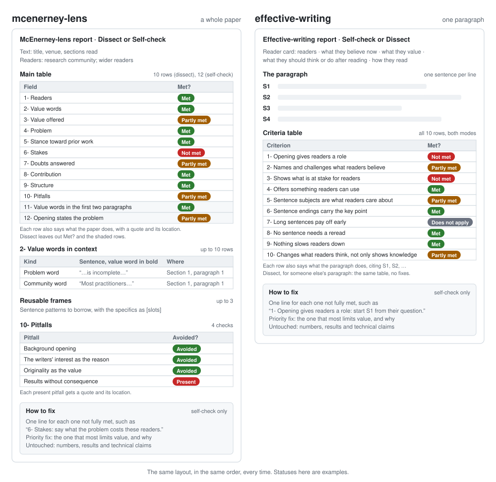
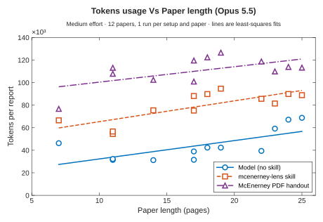
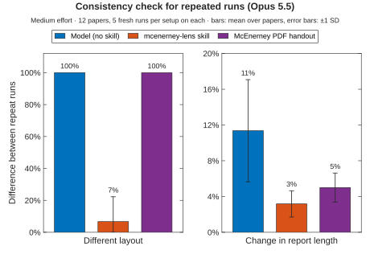

# Researchward

**Read for value. Write for readers.**

Most researchers revise a paper for clarity: shorter sentences, cleaner grammar, a tighter structure. Expert readers, however, read for value, not clarity. They stop when they can't find a problem they care about, or what it costs them to ignore it, and a clear paper that hides its problem still gets skimmed or rejected. Grammar checkers and AI editors work on the prose; they don't check for that. Researchward's skills do: they read a paper the way its readers will, find its problem, stakes, and value, and point to the sentence where each appears, so you can see how a paper you admire wins its readers, or where your own draft loses them.

The same reading helps when the paper isn't yours. Experts can skim a paper for its problem and contribution in minutes, but that skill takes years to build, and without it, a reader can spend an afternoon on a paper before realizing it wasn't for them. The lens does that skim with you: whether you're a PhD student, a postdoc, a reviewer or a professor, in any field, it shows what a paper sets out to solve, what it costs to ignore, what it offers, and where each is stated, so you can decide quickly whether it deserves your time.

**Why McEnerney?** Larry McEnerney taught writing at the University of Chicago for more than 40 years and directed its Writing Program, which teaches more than 2,000 members of the university each year. He was among the first graduate students to teach the Little Red Schoolhouse, the writing course built by Joseph M. Williams and Gregory G. Colomb, two of the authors of *The Craft of Research*, and he received the university's Quantrell Award for excellence in teaching in 1997. His lecture *The Craft of Writing Effectively* has been viewed millions of times on YouTube, and its central claim, that expert readers read for value, not clarity, is the method these skills put to work. The skills are built on his Leadership Lab lectures and work with Claude, ChatGPT, and Codex.

**For every field.** Every discipline has expert readers who want a problem, its cost, and a contribution, so the skills work wherever research is written: the humanities, the social sciences, the natural sciences, engineering, and professional fields such as law, medicine, education, and business. McEnerney's own examples come from history, literary studies, economics and biology. A historian can dissect an article on the French Revolution before deciding to cite it; a sociologist can self-check a journal draft; a law student can check the opening paragraph of a law review note; a nursing researcher can check a literature review paragraph for clinicians; an economist can dissect a working paper; an engineer can self-check a conference paper.

## Install

**The easy way: give your AI agent the link.** In an agent that can run commands, such as Claude Code, Codex, Cursor, or Gemini CLI, paste:

> Install the skills from https://github.com/FASTMANMO/researchward

It reads the steps under [For AI agents](#for-ai-agents) and does the rest. Start a new session afterward so the skills load.

**Claude Code**, as a plugin that also receives updates:

```
/plugin install researchward --marketplace FASTMANMO/researchward
```

On Claude Code older than 2.1.275, run `/plugin marketplace add FASTMANMO/researchward`, then `/plugin install researchward@researchward`.

**Claude apps (web and desktop):** download [`mcenerney-lens.zip`](https://github.com/FASTMANMO/researchward/releases/latest/download/mcenerney-lens.zip) and [`effective-writing.zip`](https://github.com/FASTMANMO/researchward/releases/latest/download/effective-writing.zip). In Claude, open Customize → Skills, click **+** → Create skill → Upload a skill, and upload each file. Skills need code execution, which is under Settings → Capabilities.

**ChatGPT:** upload the same two zip files as skills. As of October 2026, OpenAI lists personal Skills for Business, Enterprise, Healthcare, and Edu workspaces.

**Any agent, one command:** `npx skills add FASTMANMO/researchward --skill mcenerney-lens` (and again with `--skill effective-writing`).

### For AI agents

To install these skills for the user:

1. Clone the repository: `git clone --depth 1 https://github.com/FASTMANMO/researchward`.
2. Copy `skills/mcenerney-lens/` and `skills/effective-writing/`, without their `evals/` folders, into the user's skills folder: `~/.claude/skills/` for Claude Code, `~/.codex/skills/` for Codex, or the folder your tool documents for Agent Skills. Each skill is a folder with a `SKILL.md`.
3. Tell the user to start a new session, then try: "Dissect this paper with the McEnerney lens" or "Check this paragraph; it's for [readers]".

## The skills

| Skill | Works on | What it does |
|---|---|---|
| [`mcenerney-lens`](skills/mcenerney-lens/SKILL.md) | a whole paper | **Dissect** a paper you're reading to decide whether it's worth your time and to see how it wins its readers: who it is written for, the value it offers, its problem, its stance toward prior work, the stakes, the doubts it answers, its contribution, its structure and its pitfalls, each with the place it appears. It describes and never grades. **Self-check** your own draft to see which of these a reader can't find, with one fix for each |
| [`effective-writing`](skills/effective-writing/SKILL.md) | one paragraph | Shows whether a paragraph keeps its readers reading: whether it gives them a role, challenges what they believe, shows what is at stake for them, and puts what they care about where they will notice it, with nothing that makes them reread. For someone else's paragraph, it gives the same table without fixes |

**Using them together.** Run the lens on your draft, then effective-writing on its opening paragraph, and you get one diagnosis instead of two: the lens judges the opening's problem and stakes, and effective-writing checks only its sentences, so nothing is flagged twice.

**One format, every time.** Every report has the same rows in the same order, however long the chat and whatever was discussed in between, so you can line up reports on ten papers and compare their problems and stakes row by row. For a long run of papers, a new chat per paper is still the surest way to get identical layouts. A skill loads only when you use it; the [Benchmark](#benchmark) shows what a report takes.

## Try it

Ask in plain words; you don't need to name the skill. In a test of 26 wordings, each run five times on Opus, Sonnet, and Haiku 5.5, the right skill fired every time, and neither fired for nearby tasks such as a summary or a typo fix.

### mcenerney-lens

For a whole paper, someone else's or your own draft:

- "Dissect this history article with the McEnerney lens." (attach the PDF)
- "Self-check my sociology paper draft with the McEnerney lens."
- "Is this paper worth reading closely? What does it offer me?" (attach the PDF)
- "Dissect this law review article, then run effective-writing on its opening paragraph."

### effective-writing

For one paragraph; say who it is for, so the check can judge it against those readers:

- "Check this paragraph from my literature review. It's for education researchers who study classroom assessment."
- "Check this paragraph from my draft. It's for LES modelers who use eddy-viscosity closures."
- "Check the first paragraph of my abstract. It's for reviewers at a public health journal."

## Report structure

<p align="center">
  
</p>

## Benchmark

<p align="center">
  
</p>

A skill that runs McEnerney's whole method on every paper sounds costly, but it uses fewer tokens than the usual shortcut of handing the model his handout. Across 12 papers of 7 to 25 pages, a report with the skill took about 35K tokens more than the model alone and about 30K fewer than the handout, and the gaps stay about the same from short papers to long ones. The skill spends those extra tokens on working through McEnerney's method, not on a longer report: its reports are the shortest of the three.

<p align="center">
  
</p>

Comparing papers only works if every report is built the same way, and without the skill it never is. Each paper was dissected five times, each time in a fresh session. *Different layout* is the share of report pairs whose skeletons don't match (the headings, the table columns and how many rows each table has, whatever the text inside says), and *change in report length* is how much the word count moves from one run to the next. Without the skill, even with the handout, all 120 runs came back with a layout of their own and lengths that moved by 5% to 11%, so you can't tell a real difference between two papers from a change of format. With the skill, 58 of 60 runs matched the other runs on their paper, and the length moved by about 3%. The skill's 7% comes from the one place its skeleton can vary: the value-words table, which may have up to 10 rows, where two runs listed 6 and 9 sentences instead of 10. Everything else was identical, so you can line up ten papers and compare them row by row.

## Sources and credit

The handouts include a lecture timestamp for each method, so you can check any rule in the skills against McEnerney's own words.

### The lectures

- L. McEnerney, *Leadership Lab: The Craft of Writing Effectively*, University of Chicago Writing Program. Posted on YouTube by UChicago Social Sciences, 26 June 2014. https://youtu.be/vtIzMaLkCaM (the source of `mcenerney-lens` and Handout 1)
- L. McEnerney, *Leadership Lab: Writing Beyond the Academy*, University of Chicago, 23 January 2015. Posted on YouTube by UChicago Social Sciences, 18 February 2015. https://youtu.be/aFwVf5a3pZM (the source of `effective-writing` and Handout 2)

### Works the lectures cite

McEnerney uses these as examples. Reading their openings is a quick way to see the methods at work.

*The Craft of Writing Effectively*

- W. H. Sewell Jr., "Historical events as transformations of structures: Inventing revolution at the Bastille," *Theory and Society*, 25(6), 841–881, 1996. doi:10.1007/BF00159818. (The "Ever since Herodotus" opening: a problem built in the first paragraph, with its two reader communities named.)
- J. Tutino, "The revolution in Mexican independence: Insurgency and the renegotiation of property, production, and patriarchy in the Bajío, 1800–1855," *Hispanic American Historical Review*, 78(3), 367ff., 1998. (An opening that directly challenges an entrenched view.)
- E. W. Said, *Orientalism*, Pantheon Books, 1978. (Its introduction defines several communities of readers.)
- J.-F. Lyotard, *The Postmodern Condition: A Report on Knowledge* (1979), trans. G. Bennington and B. Massumi, Manchester University Press, 1984, section 1. (Knowledge becoming exterior to the knower and taking the form of a commodity.)
- L. Wittgenstein, *Philosophical Investigations*, Blackwell, 1953. ("What something means is what it does.")
- R. C. Vrijenhoek, "Factors affecting clonal diversity and coexistence," *American Zoologist*, 19, 787–797, 1979. (Background to the frozen niche-variation model in the lecture's biology example.)

*Writing Beyond the Academy*

- R. B. Myerson, "Large Poisson games," *Journal of Economic Theory*, 94(1), 7–45, 2000. doi:10.1006/jeth.1998.2453. (Example 1.)
- S. Gehlbach, R. Myerson and T. Mylovanov, "A way forward for Ukraine," *The New York Times*, 19 March 2014. (Example 2.)
- R. B. Myerson, "A field manual for the cradle of civilization: Theory of leadership and lessons of Iraq," *Journal of Conflict Resolution*, 53(3), 470–482, 2009. (Example 3.)
- J. M. Williams, "The phenomenology of error," *College Composition and Communication*, 32(2), 152–168, 1981. (The article with about 100 planted errors.)
- A. Lincoln, Second Inaugural Address, 4 March 1865. (Its final sentence is the stress example.)
- L. Wittgenstein, *Philosophical Investigations*, Blackwell, 1953. ("Form of life" and "language game.")

### Further reading (not named in the lectures)

- W. C. Booth, G. G. Colomb and J. M. Williams, *The Craft of Research*, University of Chicago Press, 4th ed., 2016, with J. Bizup and W. T. FitzGerald.
- G. D. Gopen and J. A. Swan, "The science of scientific writing," *American Scientist*, 78(6), 550–558, 1990.
- J. M. Williams, *Style: Lessons in Clarity and Grace*, Pearson; many editions, later ones with J. Bizup.

The handouts in [`docs/handouts/`](docs/handouts/) are unofficial study notes that paraphrase the lectures. This repository is not affiliated with the University of Chicago.

## License

© 2026 Mohammed Meligy, Mechanical and Aerospace Engineering, Arizona State University.

- **Skills, tests and scripts** (`skills/`, `tests/`, the code in `benchmarks/`): [MIT](LICENSE). Use, change and share them freely, in any project, as long as the copyright notice stays with them.
- **Handouts, figures and benchmark data** (`docs/handouts/`, `docs/images/`, `benchmarks/data/`): [CC BY 4.0](LICENSE-CC-BY-4.0). Share and adapt them for any purpose, as long as you credit the author, link to the license and say what you changed.

The methods come from Larry McEnerney's lectures, credited under [Sources and credit](#sources-and-credit); these licenses cover this repository's own text, code and data, not his lectures.

**How to credit:** *Researchward* by Mohammed Meligy (Arizona State University), https://github.com/FASTMANMO/researchward.
